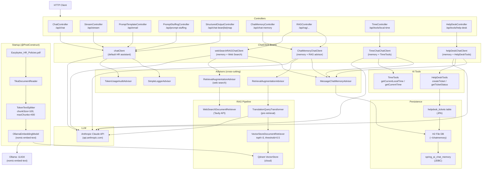

# spring-ai-rag-pipeline

A comprehensive Spring AI demo application demonstrating RAG (Retrieval-Augmented Generation), AI tool use, chat memory, streaming, and structured output patterns using Spring Boot 4 and Spring AI 2.0.

---

## Overview

**Problem statement:** Building LLM-powered applications from scratch requires wiring together many components — prompt management, conversational memory, vector search, tool calling, and observability — without a consistent framework.

**Purpose:** This project is a learning and reference implementation that demonstrates how Spring AI 2.0 integrates all those concerns into a cohesive programming model. It covers the full spectrum of GenAI patterns in a single Spring Boot application.

**Concepts demonstrated:**
- Basic chat via `ChatClient` with system/user prompt overrides
- Server-Sent Events (SSE) streaming responses via `Flux<String>`
- Prompt engineering with StringTemplate (`.st`) file templates and variable substitution
- Prompt stuffing: injecting static knowledge into the system prompt
- Structured output: mapping LLM responses directly to Java records, `List`, or `Map`
- Conversational memory backed by JDBC (H2) with per-user session isolation
- RAG pipeline: PDF loading → Tika parsing → token-based chunking → Ollama embedding → Qdrant vector store → `RetrievalAugmentationAdvisor` retrieval → LLM answer
- Advanced RAG pre-retrieval: multilingual query translation via `TranslationQueryTransformer`
- Web-search RAG: replacing the vector store with live Tavily web search results
- AI tool use (function calling): `@Tool`-annotated beans called autonomously by the model
- Help-desk agent: LLM creates/reads support tickets through database-backed tools
- Cross-cutting observability: token-usage logging, `SimpleLoggerAdvisor`, Prometheus metrics, OpenTelemetry traces to Jaeger

---

## Key Features

- Multiple named `ChatClient` beans, each specialised for a different AI pattern
- `ChatClientBuilderCustomizer` beans that inject global advisors into every `ChatClient`
- `RetrievalAugmentationAdvisor` for automatic context injection from a Qdrant vector store
- `TranslationQueryTransformer` for automatic English query translation before retrieval
- Custom `DocumentRetriever` implementation (`WebSearchDocumentRetriever`) that fetches live results from the Tavily Search API
- `TokenUsageAuditAdvisor` — a custom `CallAdvisor` that logs prompt/completion token counts after every call
- `HRPolicyLoader` — `@PostConstruct` component that reads a PDF with Apache Tika and ingests chunks into Qdrant at startup
- `HelpDeskTools` — Spring AI `@Tool`-annotated service that creates and retrieves support tickets stored in H2 via JPA
- `TimeTools` — `@Tool`-annotated component returning real-time clock values in any IANA time zone
- Spring Boot Actuator with Prometheus endpoint and OpenTelemetry OTLP export to Jaeger

---

## Technology Stack

| Component | Technology | Version |
|---|---|---|
| Language | Java | 17 |
| Framework | Spring Boot | 4.0.8-SNAPSHOT |
| AI Framework | Spring AI | 2.0.0 |
| LLM (chat) | Anthropic Claude | `claude-sonnet-latest` (config) / `claude-sonnet-4-5` (code) |
| Embedding model | Ollama `nomic-embed-text` | local |
| Vector store | Qdrant Cloud | managed (gRPC port 6334) |
| Chat memory store | H2 (file-based) + JDBC | H2 runtime |
| ORM | Spring Data JPA + Hibernate | via Spring Boot |
| Document parser | Apache Tika (via `spring-ai-tika-document-reader`) | Spring AI BOM |
| PDF reader | `spring-ai-pdf-document-reader` | Spring AI BOM |
| Web search API | Tavily Search API | REST (external) |
| Reactive runtime | Project Reactor (`Flux`) | Spring WebFlux |
| Metrics | Micrometer + Prometheus | via Spring Boot Actuator |
| Tracing | OpenTelemetry OTLP → Jaeger | `spring-boot-starter-opentelemetry` |
| JSON serialisation | Jackson | Spring Boot managed |
| Boilerplate reduction | Lombok | optional |
| Build | Maven Wrapper (`mvnw`) | Maven 3 |

> **Note on Spring Boot 4.0.8-SNAPSHOT:** This is a snapshot build pulled from the Spring snapshots repository (`https://repo.spring.io/snapshot`). It is a pre-release version and may not be stable. Dependencies are resolved at build time from the remote snapshot repo.

---

## Prerequisites

| Prerequisite | Notes |
|---|---|
| Java 17+ | `JAVA_HOME` must point to JDK 17 |
| Maven 3.8+ | Or use the bundled `./mvnw` wrapper |
| Ollama | Must be running locally; pull the `nomic-embed-text` model: `ollama pull nomic-embed-text` |
| Qdrant Cloud account | Free tier works; create a cluster and a collection named `my-documents` |
| Anthropic API key | Required to call Anthropic Claude. Obtain from [console.anthropic.com](https://console.anthropic.com) and set as `ANTHROPIC_API_KEY` |
| Tavily Search API key | Required only for the `/api/rag/web-search/chat` endpoint |
| Jaeger (optional) | For distributed tracing; the OTLP endpoint defaults to `localhost:4318` |

---

## Configuration

All sensitive values are passed as environment variables. The file `src/main/resources/application.properties` references them via `${VAR_NAME}`.

### Environment Variables

| Variable | Used By | Description |
|---|---|---|
| `ANTHROPIC_API_KEY` | `spring.ai.anthropic.api-key` | Anthropic API key. Obtain from [console.anthropic.com](https://console.anthropic.com). |
| `QDRANT_API_KEY` | `spring.ai.vectorstore.qdrant.api-key` | Qdrant Cloud API key |
| `TAVILY_SEARCH_API_KEY` | `WebSearchDocumentRetriever` | Tavily Search REST API key (read directly via `System.getenv()`) |

### application.properties Key Properties

| Property | Default / Example Value | Purpose |
|---|---|---|
| `spring.ai.anthropic.api-key` | `${ANTHROPIC_API_KEY}` | Anthropic API key |
| `spring.ai.anthropic.base-url` | `https://api.anthropic.com` | Anthropic API endpoint |
| `spring.ai.anthropic.chat.options.model` | `claude-sonnet-latest` | Default Anthropic model |
| `spring.ai.model.chat` | `anthropic` | Active chat model provider |
| `spring.ai.ollama.embedding.model` | `nomic-embed-text` | Ollama embedding model |
| `spring.ai.model.embedding` | `ollama` | Active embedding model provider |
| `spring.ai.vectorstore.qdrant.host` | `5735d89a-...qdrant.io` | Qdrant Cloud hostname |
| `spring.ai.vectorstore.qdrant.port` | `6334` | Qdrant gRPC port |
| `spring.ai.vectorstore.qdrant.api-key` | `${QDRANT_API_KEY}` | Qdrant API key |
| `spring.ai.vectorstore.qdrant.collection-name` | `my-documents` | Qdrant collection |
| `spring.ai.vectorstore.qdrant.use-tls` | `true` | TLS for Qdrant Cloud connection |
| `spring.ai.vectorstore.qdrant.initialize-schema` | `true` | Auto-create collection if absent |
| `spring.datasource.url` | `jdbc:h2:file:~/chatmemory;AUTO_SERVER=true` | H2 file database for chat memory |
| `spring.datasource.username` | `Hemanth` | H2 username |
| `spring.datasource.password` | `12345` | H2 password |
| `spring.h2.console.enabled` | `true` | Enable H2 web console |
| `spring.h2.console.path` | `/h2-console` | H2 console URL path |
| `spring.ai.chat.memory.repository.jdbc.initialize-schema` | `always` | Auto-create chat memory tables |
| `audit.token-usage.enabled` | `true` | Enables `TokenUsageAuditAdvisor` globally |
| `management.endpoints.web.exposure.include` | `health,metrics,prometheus,beans,env,conditions` | Exposed Actuator endpoints |
| `management.opentelemetry.tracing.export.otlp.endpoint` | `http://localhost:4318/v1/traces` | Jaeger OTLP endpoint |
| `management.tracing.sampling.probability` | `1.0` | 100% trace sampling |
| `management.otlp.metrics.export.enabled` | `false` | Disable OTLP metrics (Jaeger doesn't support) |

---

## Project Structure

```
spring-ai-rag-pipeline/
├── pom.xml
├── mvnw / mvnw.cmd                          # Maven wrapper
├── .mvn/wrapper/maven-wrapper.properties
└── src/
    ├── main/
    │   ├── java/com/springAI/simpleproject/
    │   │   ├── SpringAiSimpleProjectApplication.java   # Entry point
    │   │   ├── advisors/
    │   │   │   └── TokenUsageAuditAdvisor.java         # Custom CallAdvisor for token logging
    │   │   ├── config/                                 # ChatClient bean definitions
    │   │   │   ├── ChatClientBuilderCustomizerConfig.java
    │   │   │   ├── ChatClientConfig.java
    │   │   │   ├── ChatMemoryChatClientConfig.java
    │   │   │   ├── HelpDeskChatClientConfig.java
    │   │   │   ├── TimeChatChatClientConfig.java
    │   │   │   └── WebSearchRAGChatClientConfig.java
    │   │   ├── controller/                             # REST endpoints
    │   │   │   ├── ChatController.java
    │   │   │   ├── ChatMemoryController.java
    │   │   │   ├── HelpDeskController.java
    │   │   │   ├── PromptStuffingController.java
    │   │   │   ├── PromptTemplateController.java
    │   │   │   ├── RAGController.java
    │   │   │   ├── StreamController.java
    │   │   │   ├── StructuredOutputController.java
    │   │   │   └── TimeController.java
    │   │   ├── entity/
    │   │   │   └── HelpDeskTicket.java                 # JPA entity for support tickets
    │   │   ├── model/
    │   │   │   ├── CountryCities.java                  # Structured output record
    │   │   │   └── TicketRequest.java                  # Tool parameter record
    │   │   ├── rag/
    │   │   │   ├── HRPolicyLoader.java                 # PDF ingestion at startup
    │   │   │   ├── RandomDataLoader.java               # Disabled (@Component commented out)
    │   │   │   └── WebSearchDocumentRetriever.java     # Tavily search DocumentRetriever
    │   │   ├── repository/
    │   │   │   └── HelpDeskTicketRepository.java       # JPA repository
    │   │   ├── service/
    │   │   │   └── HelpDeskTicketService.java          # Ticket CRUD service
    │   │   └── tools/
    │   │       ├── HelpDeskTools.java                  # @Tool: create/get tickets
    │   │       └── TimeTools.java                      # @Tool: current time
    │   └── resources/
    │       ├── application.properties
    │       ├── Eazybytes_HR_Policies.pdf               # Source document for HR RAG
    │       └── promptTemplates/
    │           ├── helpDeskSystemPromptTemplate.st     # Help-desk agent system prompt
    │           ├── systemPromptDocumentTemplate.st     # HR policy RAG system prompt (legacy)
    │           ├── systemPromptRandomDataTemplate.st   # Random data RAG system prompt (legacy)
    │           ├── systemPromptTemplate.st             # HR policy stuffing system prompt
    │           └── userPromptTemplate.st               # Email drafting user prompt template
    └── test/
        └── java/com/springAI/simpleproject/
            └── SpringAiSimpleProjectApplicationTests.java  # Context load smoke test only
```

**Important directories:**
- `config/` — All `ChatClient` bean wiring lives here. Each class is responsible for one ChatClient variant.
- `rag/` — Document loading and the custom Tavily retriever live here.
- `tools/` — `@Component` beans with `@Tool`-annotated methods that the LLM can invoke.
- `resources/promptTemplates/` — StringTemplate (`.st`) files used via `@Value("classpath:...")` injection.

---

## Architecture



**Component summary:**

| Component | Role |
|---|---|
| `ChatClient` beans | Named beans, each carrying a specific advisor/tool/system-prompt configuration |
| `ChatClientBuilderCustomizer` | Spring mechanism to inject advisors into ALL clients through the shared `ChatClient.Builder` |
| `RetrievalAugmentationAdvisor` | Intercepts each request, retrieves relevant chunks, and augments the prompt before the LLM call |
| `TranslationQueryTransformer` | Pre-retrieval step: translates the user query to English before vector search |
| `VectorStoreDocumentRetriever` | Queries Qdrant with topK=3 and cosine similarity threshold ≥ 0.5 |
| `WebSearchDocumentRetriever` | Queries Tavily and maps results to `Document` objects |
| `MessageChatMemoryAdvisor` | Reads/writes per-session conversation history from/to H2 via JDBC |
| `TokenUsageAuditAdvisor` | Post-call advisor that logs token usage from `ChatResponse.getMetadata()` |
| `HRPolicyLoader` | Loads and chunks `Eazybytes_HR_Policies.pdf` into Qdrant at startup |
| `TimeTools` / `HelpDeskTools` | `@Component` beans with `@Tool` methods; the LLM can call these autonomously |

---

## Detailed Execution Flow

### Flow 1 — Basic Chat (`/api/chat`)

1. HTTP GET hits `ChatController.chat(message)`.
2. `chatClient` (default bean from `ChatClientConfig`) is called with `.prompt().user(message).call().content()`.
3. The `ChatClient.Builder` has been customised by `ChatClientBuilderCustomizerConfig`, which added `SimpleLoggerAdvisor` and (when `audit.token-usage.enabled=true`) `TokenUsageAuditAdvisor` to all clients built from the shared builder.
4. `ChatClientConfig` additionally adds `SimpleLoggerAdvisor` and `TokenUsageAuditAdvisor` directly to this specific client — resulting in duplicated advisors on this client (see Limitations).
5. The default system prompt (HR assistant persona) and default user message are applied if not overridden per-request.
6. `SimpleLoggerAdvisor` logs the request and response at DEBUG level.
7. The prompt is sent to Anthropic Claude at `https://api.anthropic.com`.
8. `TokenUsageAuditAdvisor` logs token counts from the response metadata.
9. The content string is returned as the HTTP response body.

### Flow 2 — RAG Document Chat (`/api/rag/document/chat`)

1. HTTP GET hits `RAGController.documentChat(username, message)` with a `username` header.
2. The `ChatMemoryChatClient` bean (from `ChatMemoryChatClientConfig`) is invoked.
3. The `MessageChatMemoryAdvisor` fetches the last 10 messages for the given `username` from H2 and prepends them to the request.
4. The `RetrievalAugmentationAdvisor` intercepts the request:
   a. The `TranslationQueryTransformer` sends the user query to Anthropic Claude to translate it to English (another LLM call).
   b. The translated query is embedded by Ollama (`nomic-embed-text`).
   c. `VectorStoreDocumentRetriever` runs a similarity search against Qdrant: topK=3, cosine similarity threshold ≥ 0.5.
   d. Retrieved document chunks are injected into the prompt context automatically.
5. The augmented prompt is sent to Anthropic Claude.
6. The response is returned; `MessageChatMemoryAdvisor` saves the exchange to H2; `TokenUsageAuditAdvisor` logs token usage.

### Flow 3 — Web Search RAG (`/api/rag/web-search/chat`)

1. HTTP GET hits `RAGController.webSearchChat(username, message)`.
2. The `webSearchRAGChatClient` (from `WebSearchRAGChatClientConfig`) is used.
3. Its `RetrievalAugmentationAdvisor` uses `WebSearchDocumentRetriever` instead of `VectorStoreDocumentRetriever`.
4. `WebSearchDocumentRetriever.retrieve(query)` POSTs to `https://api.tavily.com/search` with `searchDepth=advanced` and `maxResults=5`, using the `TAVILY_SEARCH_API_KEY` env variable.
5. Up to 5 result documents (title, URL, content, score) are mapped to Spring AI `Document` objects.
6. These documents are injected into the prompt; the LLM answers using live web content.

### Flow 4 — HelpDesk Agent (`/api/tools/help-desk`)

1. HTTP GET hits `HelpDeskController.helpDesk(username, message)`.
2. `helpDeskChatClient` is used; its system prompt comes from `helpDeskSystemPromptTemplate.st`.
3. `HelpDeskTools` is registered as a tool provider; `ToolContext` carries the `username` value.
4. The LLM decides whether to call `createTicket` or `getTicketStatus` based on the user message.
5. If `createTicket` is called, `HelpDeskTicketService.createTicket()` saves a new `HelpDeskTicket` to H2 with status `OPEN` and ETA 7 days from now.
6. The tool result is returned directly to the caller (`returnDirect = true` on `createTicket`) without passing through the LLM again.
7. `getTicketStatus` returns the list of tickets to the LLM for formatting.

### Flow 5 — Streaming (`/api/stream`)

1. HTTP GET hits `StreamController.stream(message)`.
2. `.stream().content()` is called instead of `.call().content()`.
3. Returns a `Flux<String>` streamed as Server-Sent Events.

---

## RAG Pipeline Details

### Document Loading

- **Loader class:** `HRPolicyLoader` (`src/main/java/.../rag/HRPolicyLoader.java`)
- **Trigger:** `@PostConstruct` — runs automatically on every application startup
- **Source file:** `src/main/resources/Eazybytes_HR_Policies.pdf`
- **File type:** PDF

### Parsing

- **Parser:** Apache Tika via `TikaDocumentReader` (Spring AI Tika integration)
- `TikaDocumentReader` extracts plain text from the PDF using Tika's auto-detection
- Raw text is returned as one or more `Document` objects

### Chunking

- **Splitter:** `TokenTextSplitter` (Spring AI)
- **Chunk size:** 100 tokens
- **Max chunks:** 400
- **Overlap:** Default (not explicitly configured — Spring AI `TokenTextSplitter` default overlap applies)
- The splitter splits the Tika output before ingestion: `textSplitter.split(docs)`

### Embedding

- **Model:** Ollama `nomic-embed-text`
- **Provider:** Local Ollama instance
- **Configuration:** `spring.ai.model.embedding=ollama`, `spring.ai.ollama.embedding.model=nomic-embed-text`
- Embeddings are computed automatically by the `VectorStore.add()` call

### Vector Store

- **Technology:** Qdrant Cloud (managed)
- **Connection:** gRPC on port 6334 with TLS
- **Collection:** `my-documents`
- **Similarity strategy:** Cosine (Qdrant default; `check-compatibility=false` skips the vector size handshake)
- **Auto schema init:** `spring.ai.vectorstore.qdrant.initialize-schema=true`

### Retrieval

- **Component:** `VectorStoreDocumentRetriever` configured in `ChatMemoryChatClientConfig.retrievalAugmentationAdvisor()`
- **Top-K:** 3 documents
- **Similarity threshold:** 0.5 (cosine score)
- **Pre-retrieval transformer:** `TranslationQueryTransformer` — uses an additional Anthropic LLM call to translate the user query to English before vectorising it

### Prompt Construction

- The `RetrievalAugmentationAdvisor` automatically appends retrieved document chunks to the prompt as context
- Previously, manual context injection was done via `systemPromptDocumentTemplate.st` and `systemPromptRandomDataTemplate.st` (the `{documents}` placeholder approach). This code is now commented out in `RAGController`; the advisor handles it instead.

### LLM Generation

- **Model:** Anthropic Claude (model = `claude-sonnet-latest` per `application.properties`, overridden to `claude-sonnet-4-5` in `ChatClientConfig` code comment — active model from properties is `claude-sonnet-latest`)
- **Endpoint:** Anthropic API at `https://api.anthropic.com`

### Response

- The LLM answer is returned as a plain `String` via `ResponseEntity<String>`

---

## API Documentation

All endpoints are GET requests that accept query parameters. Endpoints requiring per-user session isolation expect a `username` header.

### Basic Chat

**GET /api/chat**

| Parameter | Type | Description |
|---|---|---|
| `message` | query | User's chat message |

```bash
curl "http://localhost:8080/api/chat?message=What+is+your+leave+policy"
```

---

### Streaming Chat

**GET /api/stream**

Returns a `text/event-stream` of `String` chunks.

| Parameter | Type | Description |
|---|---|---|
| `message` | query | User's chat message |

```bash
curl -N "http://localhost:8080/api/stream?message=Tell+me+about+Spring+AI"
```

---

### Email Drafting (Prompt Template)

**GET /api/email**

Uses `userPromptTemplate.st` with variable substitution.

| Parameter | Type | Description |
|---|---|---|
| `customerName` | query | Customer's name |
| `customerMessage` | query | Customer's complaint or message |

```bash
curl "http://localhost:8080/api/email?customerName=Alice&customerMessage=My+order+is+delayed"
```

---

### Prompt Stuffing

**GET /api/prompt-stuffing**

Uses `systemPromptTemplate.st` which contains static HR policy text as the system prompt.

| Parameter | Type | Description |
|---|---|---|
| `message` | query | User's question |

```bash
curl "http://localhost:8080/api/prompt-stuffing?message=How+many+days+of+maternity+leave+do+I+get"
```

---

### Structured Output

**GET /api/chat-bean** — Returns a `CountryCities` JSON object `{"country":"...","cities":[...]}`

**GET /api/chat-list** — Returns a `List<String>` JSON array

**GET /api/chat-map** — Returns a `Map<String,Object>` JSON object

**GET /api/chat-bean-list** — Returns a `List<CountryCities>` JSON array

All accept:

| Parameter | Type | Description |
|---|---|---|
| `message` | query | Natural language question (e.g., "List the top 5 cities in India") |

```bash
curl "http://localhost:8080/api/chat-bean?message=List+5+cities+in+Japan"
# Response: {"country":"Japan","cities":["Tokyo","Osaka","Kyoto","Hiroshima","Sapporo"]}

curl "http://localhost:8080/api/chat-list?message=List+5+programming+languages"
# Response: ["Java","Python","JavaScript","Go","Rust"]
```

---

### Chat with Memory

**GET /api/chat-memory**

Uses `ChatMemoryChatClient` which includes `MessageChatMemoryAdvisor` + `RetrievalAugmentationAdvisor`.

| Parameter | Type | Location | Description |
|---|---|---|---|
| `username` | string | header | Session identifier for per-user memory |
| `message` | string | query | User's message |

```bash
curl -H "username: alice" "http://localhost:8080/api/chat-memory?message=What+is+the+notice+period"
```

---

### RAG — Vector Store Chat (Random Data)

**GET /api/rag/random/chat**

Uses `ChatMemoryChatClient` with `RetrievalAugmentationAdvisor` querying the Qdrant vector store.

| Parameter | Type | Location | Description |
|---|---|---|---|
| `username` | string | header | Session identifier |
| `message` | string | query | User's question |

```bash
curl -H "username: bob" "http://localhost:8080/api/rag/random/chat?message=What+is+Kubernetes+used+for"
```

---

### RAG — HR Document Chat

**GET /api/rag/document/chat**

Same as random/chat but context comes from HR policy PDF chunks ingested at startup.

| Parameter | Type | Location | Description |
|---|---|---|---|
| `username` | string | header | Session identifier |
| `message` | string | query | HR-related question |

```bash
curl -H "username: charlie" "http://localhost:8080/api/rag/document/chat?message=What+is+the+maternity+leave+policy"
```

---

### RAG — Web Search Chat

**GET /api/rag/web-search/chat**

Retrieves context from live Tavily web search results.

| Parameter | Type | Location | Description |
|---|---|---|---|
| `username` | string | header | Session identifier |
| `message` | string | query | Any question |

```bash
curl -H "username: dave" "http://localhost:8080/api/rag/web-search/chat?message=Latest+Spring+AI+features+2025"
```

---

### Time Tool

**GET /api/tools/local-time**

The LLM calls `TimeTools` to fetch the current time.

| Parameter | Type | Location | Description |
|---|---|---|---|
| `username` | string | header | Session identifier |
| `message` | string | query | e.g., "What time is it in Tokyo?" |

```bash
curl -H "username: eve" "http://localhost:8080/api/tools/local-time?message=What+time+is+it+in+New+York"
```

---

### HelpDesk Agent

**GET /api/tools/help-desk**

The LLM autonomously decides whether to create a new ticket or check existing ticket status.

| Parameter | Type | Location | Description |
|---|---|---|---|
| `username` | string | header | Used as session ID and ticket owner |
| `message` | string | query | User's support request |

```bash
# Create a ticket
curl -H "username: frank" "http://localhost:8080/api/tools/help-desk?message=My+laptop+is+not+turning+on"

# Check ticket status
curl -H "username: frank" "http://localhost:8080/api/tools/help-desk?message=What+is+the+status+of+my+tickets"
```

---

## Core Components and Classes

### `SpringAiSimpleProjectApplication`
- **Package:** `com.springAI.simpleproject`
- **Responsibility:** Standard Spring Boot entry point; annotated with `@SpringBootApplication`.

---

### `TokenUsageAuditAdvisor`
- **Package:** `com.springAI.simpleproject.advisors`
- **Implements:** `CallAdvisor`
- **Responsibility:** Post-call advisor that extracts `Usage` from `ChatResponse.getMetadata()` and logs it with SLF4J.
- **Order:** 1 (runs before `SimpleLoggerAdvisor` which is order 0; higher order = earlier execution)
- **Key method:** `adviseCall(ChatClientRequest, CallAdvisorChain)` — delegates to chain, then logs.

---

### `ChatClientBuilderCustomizerConfig`
- **Package:** `com.springAI.simpleproject.config`
- **Responsibility:** Declares `ChatClientBuilderCustomizer` beans that are automatically applied to Spring AI's shared `ChatClient.Builder` bean, adding `SimpleLoggerAdvisor` and (conditionally) `TokenUsageAuditAdvisor` to ALL `ChatClient` beans that use the shared builder.
- **Condition:** `@ConditionalOnProperty(name = "audit.token-usage.enabled", havingValue = "true")`

---

### `ChatClientConfig`
- **Package:** `com.springAI.simpleproject.config`
- **Responsibility:** Defines the default `chatClient` bean (HR assistant) and `anthropicAIChatClient` (bare Anthropic model client). The default client has `SimpleLoggerAdvisor`, `TokenUsageAuditAdvisor`, a default system prompt, and a default user message.
- **Note:** This config also adds advisors directly in addition to those from `ChatClientBuilderCustomizerConfig`, causing duplication on the default `chatClient`.

---

### `ChatMemoryChatClientConfig`
- **Package:** `com.springAI.simpleproject.config`
- **Beans:**
  - `chatMemory` — `MessageWindowChatMemory` backed by `JdbcChatMemoryRepository`, window size 10.
  - `ChatMemoryChatClient` — ChatClient with memory + RAG + logger + token advisors.
  - `retrievalAugmentationAdvisor` — `RetrievalAugmentationAdvisor` with `TranslationQueryTransformer` + `VectorStoreDocumentRetriever(topK=3, threshold=0.5)`.

---

### `HelpDeskChatClientConfig`
- **Package:** `com.springAI.simpleproject.config`
- **Bean:** `helpDeskChatClient` — ChatClient with system prompt from `helpDeskSystemPromptTemplate.st`, `TimeTools` registered as a default tool, and `MessageChatMemoryAdvisor`.

---

### `TimeChatChatClientConfig`
- **Package:** `com.springAI.simpleproject.config`
- **Bean:** `TimeChatChatClient` — ChatClient with `TimeTools`, memory advisor, logger, and token advisor.

---

### `WebSearchRAGChatClientConfig`
- **Package:** `com.springAI.simpleproject.config`
- **Bean:** `webSearchRAGChatClient` — ChatClient with `RetrievalAugmentationAdvisor` using `WebSearchDocumentRetriever(maxResults=5)`.

---

### `HRPolicyLoader`
- **Package:** `com.springAI.simpleproject.rag`
- **Responsibility:** Triggered by `@PostConstruct`, reads `Eazybytes_HR_Policies.pdf` via `TikaDocumentReader`, splits it with `TokenTextSplitter(chunkSize=100, maxChunks=400)`, and calls `vectorStore.add()` to persist chunks into Qdrant.
- **Warning:** Runs on every startup; documents are added each time (see Limitations).

---

### `RandomDataLoader`
- **Package:** `com.springAI.simpleproject.rag`
- **Status:** Disabled — the `@Component` annotation is commented out (`//@Component`).
- **Responsibility:** Would load 54 hard-coded sentences into the vector store at startup if enabled.

---

### `WebSearchDocumentRetriever`
- **Package:** `com.springAI.simpleproject.rag`
- **Implements:** `DocumentRetriever`
- **Responsibility:** Custom retriever that calls the Tavily Search REST API and maps each result to a Spring AI `Document` with title, URL, content, and score metadata.
- **Auth:** Reads `TAVILY_SEARCH_API_KEY` from `System.getenv()` in constructor.
- **Request format:** `TavilyRequestPayload(query, "advanced", maxResults)` as POST body.
- **Builder pattern:** Uses a nested `Builder` class.

---

### `HelpDeskTools`
- **Package:** `com.springAI.simpleproject.tools`
- **Responsibility:** Spring AI tool definitions for the help-desk agent.
- **Tools:**
  - `createTicket(TicketRequest, ToolContext)` — Creates a `HelpDeskTicket` via `HelpDeskTicketService`; `returnDirect=true` means the tool result bypasses the LLM and goes directly to the caller.
  - `getTicketStatus(ToolContext)` — Returns all tickets for the username from `ToolContext`.
- **Username access:** Passed via `ToolContext` rather than a method parameter, injected at call time with `.toolContext(Map.of("username", username))`.

---

### `TimeTools`
- **Package:** `com.springAI.simpleproject.tools`
- **Tools:**
  - `getCurrentLocalTime()` — Returns `LocalTime.now().toString()` in the server's default timezone.
  - `getCurrentTime(timeZone)` — Returns `LocalTime.now(ZoneId.of(timeZone)).toString()` for any IANA timezone string.

---

### `HelpDeskTicket` (Entity)
- **Table:** `helpdesk_tickets`
- **Fields:** `id` (auto-generated), `username`, `issue`, `status` (OPEN/IN_PROGRESS/CLOSED), `createdAt`, `eta`
- **Initial values set by service:** `status=OPEN`, `createdAt=now()`, `eta=now()+7days`

---

### `CountryCities` (Record)
- `record CountryCities(String country, List<String> cities)`
- Used as structured output target in `StructuredOutputController`.

### `TicketRequest` (Record)
- `record TicketRequest(String issue)`
- Used as `@ToolParam` in `HelpDeskTools.createTicket()`.

---

## AI / Spring AI Details

### ChatClient Configuration Pattern

Spring AI provides a `ChatClient.Builder` bean auto-configured from `application.properties`. This project uses two layers of customisation:

1. **`ChatClientBuilderCustomizer` beans** (in `ChatClientBuilderCustomizerConfig`) — Applied globally to the shared builder. Every `ChatClient` built from the shared builder inherits these advisors.
2. **Direct builder configuration** in each config class (e.g., `.defaultAdvisors(...)`) — Adds advisors/tools/system prompts specific to one ChatClient.

### EmbeddingModel

- `OllamaEmbeddingModel` is auto-configured via `spring.ai.model.embedding=ollama` and `spring.ai.ollama.embedding.model=nomic-embed-text`.
- Used implicitly by `VectorStore.add()` and `VectorStoreDocumentRetriever`.

### VectorStore

- `QdrantVectorStore` is auto-configured via the `spring.ai.vectorstore.qdrant.*` properties.
- `initialize-schema=true` will create the Qdrant collection automatically if it does not exist.

### RetrievalAugmentationAdvisor

- Spring AI's built-in `CallAdvisor` that implements the RAG pattern.
- Intercepts the outbound `ChatClientRequest`, runs the retrieval pipeline, augments the prompt with retrieved content, then delegates to the LLM.
- Used in `ChatMemoryChatClientConfig` (vector store RAG) and `WebSearchRAGChatClientConfig` (web search RAG).

### Advisors and Execution Order

Spring AI advisors are executed in order (highest number first):
- `TokenUsageAuditAdvisor` — order 1 (runs before `SimpleLoggerAdvisor`)
- `SimpleLoggerAdvisor` — order 0 (runs after `TokenUsageAuditAdvisor`)

The `RetrievalAugmentationAdvisor` and `MessageChatMemoryAdvisor` have their own default orders and interact with the request/response at different stages.

---

## Prompt Engineering

### `systemPromptTemplate.st` — HR Policy Stuffing

Used by `PromptStuffingController` (`/api/prompt-stuffing`).

```
You are an internal HR assistant. You assist employees with queries related to HR policies
only — such as leave entitlements, working hours, benefits, and code of conduct.
HR Policy Summary:
• 18 days of paid leave annually
• Up to 8 unused leave days can be carried over to the next year
...
Politely inform users that you can only help with HR policy-related topics if they ask
something outside your scope.
```

**Purpose:** Demonstrates prompt stuffing — embedding structured knowledge directly in the system prompt rather than retrieving from a vector store.

---

### `userPromptTemplate.st` — Email Drafting

Used by `PromptTemplateController` (`/api/email`).

**Variables:** `{customerName}`, `{customerMessage}`

```
A Customer named {customerName} sent the following message :
"{customerMessage}
Write a polite and helpful email response...
```

**Purpose:** Demonstrates parameterised prompt templates using Spring AI's StringTemplate (`.st`) format.

---

### `helpDeskSystemPromptTemplate.st` — HelpDesk Agent

Used by `helpDeskChatClient` (loaded via `@Value("classpath:/promptTemplates/helpDeskSystemPromptTemplate.st")`).

**Key instructions:** Avoid duplicate tickets; keep status responses short with ETA.

---

### `systemPromptDocumentTemplate.st` and `systemPromptRandomDataTemplate.st`

Both contain a `{documents}` placeholder for manual context injection (the classic "stuff documents into prompt" RAG pattern). These templates are loaded in `RAGController` but the code that uses them is **commented out** — the `RetrievalAugmentationAdvisor` now handles context injection automatically.

---

### Default System Prompt (in `ChatClientConfig`)

```java
.defaultSystem("""
    You are a professional HR assistant.
    Help employees and managers with questions about company policies,
    benefits, leave, onboarding, performance reviews, and general HR procedures.
    Be clear, empathetic, and maintain confidentiality.
    Redirect legal or sensitive matters to the appropriate professional.
    """)
```

Applied to the default `chatClient` bean as a fallback when no per-request system prompt is provided.

---

## Database / Persistence

### H2 Chat Memory Database

- **URL:** `jdbc:h2:file:~/chatmemory;AUTO_SERVER=true`
- **Type:** File-based H2 (persists across restarts); `AUTO_SERVER=true` allows concurrent connections from multiple JVM processes.
- **Credentials:** username=`Hemanth`, password=`12345`
- **Schema init:** `spring.ai.chat.memory.repository.jdbc.initialize-schema=always` creates the `spring_ai_chat_memory` table automatically on startup.
- **Console:** Available at `http://localhost:8080/h2-console`

### HelpDesk Tickets (JPA)

- **Entity:** `HelpDeskTicket`
- **Table:** `helpdesk_tickets` (created/updated via `spring.jpa.hibernate.ddl-auto=update`)
- **Repository:** `HelpDeskTicketRepository extends JpaRepository<HelpDeskTicket, Long>`
- **Custom query:** `findByUsername(String username)` — returns all tickets for a user

### Qdrant Vector Store

- Not a relational database; manages vector embeddings and metadata.
- Collections persist in Qdrant Cloud independently of application lifecycle.
- Each document chunk stored with its embedding vector and text content.

---

## Docker / Infrastructure

There is no `docker-compose.yml` or `Dockerfile` in this repository.

**External dependencies that must be running before starting the application:**

| Service | How to run | Purpose |
|---|---|---|
| Ollama | `ollama serve` (then `ollama pull nomic-embed-text`) | Local embedding model |
| Qdrant Cloud | Managed service (no local setup needed) | Vector store |
| Jaeger (optional) | `docker run -p 4318:4318 jaegertracing/all-in-one` | Distributed tracing |

---

## Running the Application

### Step 1 — Clone the repository

```bash
git clone https://github.com/HemanthkumarS0120/spring-ai-rag-pipeline.git
cd spring-ai-rag-pipeline
```

### Step 2 — Start Ollama and pull the embedding model

```bash
ollama serve
ollama pull nomic-embed-text
```

### Step 3 — Set environment variables

**Linux/macOS:**
```bash
export ANTHROPIC_API_KEY=your-anthropic-api-key-here
export QDRANT_API_KEY=your-qdrant-api-key-here
export TAVILY_SEARCH_API_KEY=your-tavily-api-key-here
```

**Windows (PowerShell):**
```powershell
$env:ANTHROPIC_API_KEY = "your-anthropic-api-key-here"
$env:QDRANT_API_KEY = "your-qdrant-api-key-here"
$env:TAVILY_SEARCH_API_KEY = "your-tavily-api-key-here"
```

### Step 4 — Build and run

```bash
./mvnw spring-boot:run
```

Or build a JAR and run:
```bash
./mvnw clean package -DskipTests
java -jar target/Spring-AI-SimpleProject-0.0.1-SNAPSHOT.jar
```

### Step 5 — Verify startup

The application starts on port 8080 by default. On startup, `HRPolicyLoader.loadPDF()` will:
- Parse `Eazybytes_HR_Policies.pdf` via Tika
- Chunk it with `TokenTextSplitter`
- Embed each chunk via Ollama
- Push chunks to Qdrant

This may take 30–120 seconds on first run.

Check health: `curl http://localhost:8080/actuator/health`

---

## Example Usage

### Ask the default HR assistant

```bash
curl "http://localhost:8080/api/chat?message=What+is+the+notice+period+at+EazyBytes"
```

### Ask about HR policies via RAG (uses PDF chunks from Qdrant)

```bash
curl -H "username: john" \
  "http://localhost:8080/api/rag/document/chat?message=How+many+days+of+maternity+leave+can+I+take"
```

### Draft an email response

```bash
curl "http://localhost:8080/api/email?customerName=John+Doe&customerMessage=I+did+not+receive+my+order+and+it+has+been+2+weeks"
```

### Get structured output

```bash
# Returns {"country":"India","cities":["Mumbai","Delhi","Bangalore","Hyderabad","Chennai"]}
curl "http://localhost:8080/api/chat-bean?message=Give+me+5+cities+in+India"
```

### Create a help-desk ticket via AI agent

```bash
curl -H "username: alice" \
  "http://localhost:8080/api/tools/help-desk?message=My+laptop+screen+is+broken"
# Returns: "Ticket #1 created successfully for user alice"
```

### Check ticket status via AI agent

```bash
curl -H "username: alice" \
  "http://localhost:8080/api/tools/help-desk?message=What+are+my+open+tickets"
# LLM calls getTicketStatus tool and formats the response
```

### Ask a time question

```bash
curl -H "username: bob" \
  "http://localhost:8080/api/tools/local-time?message=What+time+is+it+right+now+in+Tokyo"
# LLM calls getCurrentTime("Asia/Tokyo") and responds
```

### Live web search RAG

```bash
curl -H "username: carol" \
  "http://localhost:8080/api/rag/web-search/chat?message=What+are+the+latest+Java+features+in+2025"
```

### Stream a response

```bash
curl -N "http://localhost:8080/api/stream?message=Explain+Spring+AI+in+detail"
```

---

## Testing

Only one test file exists:

**`SpringAiSimpleProjectApplicationTests.java`**
```java
@SpringBootTest
class SpringAiSimpleProjectApplicationTests {
    @Test
    void contextLoads() { }
}
```

This is a smoke test that verifies the Spring application context loads without error. It requires all infrastructure (Ollama, Qdrant, and a valid `ANTHROPIC_API_KEY`) to be available at test time.

No dedicated unit tests, integration tests for individual components, or API tests are currently implemented.

---

## Error Handling

No centralised `@ControllerAdvice` or `@ExceptionHandler` is defined. Error handling is implicit:

| Scenario | Behaviour |
|---|---|
| `TAVILY_SEARCH_API_KEY` not set | `WebSearchDocumentRetriever` throws `IllegalArgumentException` at construction time (fails at app startup if `webSearchRAGChatClient` is built) |
| `ANTHROPIC_API_KEY` / `QDRANT_API_KEY` not set | Spring Boot fails to start with a `BeanCreationException` |
| Ollama not running | Startup fails when `HRPolicyLoader` tries to embed document chunks |
| Qdrant unreachable | Startup fails during `HRPolicyLoader.loadPDF()` |
| LLM returns no content | `call().content()` may return `null`; no null-check in controllers |
| Tavily returns empty results | `WebSearchDocumentRetriever.retrieve()` returns `List.of()` gracefully |
| Tool execution exception | Commented-out code shows `DefaultToolExecutionExceptionProcessor(true)` would propagate directly to the client; current default passes the exception message to the LLM for graceful handling |

---

## Security Considerations

- **No authentication or authorisation is implemented** on any endpoint. All REST APIs are publicly accessible.
- The `username` header used for session isolation is entirely user-controlled and not validated. Any caller can read or write any user's chat history by supplying an arbitrary `username` header.
- API keys (`ANTHROPIC_API_KEY`, `QDRANT_API_KEY`, `TAVILY_SEARCH_API_KEY`) are passed via environment variables, which is the correct approach for secrets.
- H2 credentials (`Hemanth` / `12345`) are hardcoded in `application.properties`. The H2 console is enabled (`/h2-console`) and accessible without credentials verification at the network level.
- The `management.endpoints.web.exposure.include` property exposes `env`, `beans`, and `conditions` actuator endpoints, which may reveal sensitive configuration or internal bean details in a non-production environment.
- The application uses `spring.jpa.hibernate.ddl-auto=update` which auto-modifies schema in production — this is appropriate for development only.

---

## Design Decisions

### Decision 1 — Named ChatClient beans per feature
**What:** Six separate named `ChatClient` beans, each in its own `@Configuration` class.
**Why:** Each AI feature (RAG, helpdesk, time tool, web search) requires a different advisor chain and tool set. Separating them prevents cross-contamination and makes each feature independently configurable.
**Alternative:** One generic `ChatClient` configured per-request.
**Trade-off:** More beans and config classes; harder to spot shared advisors being duplicated across classes.

### Decision 2 — ChatClientBuilderCustomizer for global advisors
**What:** `ChatClientBuilderCustomizerConfig` adds `SimpleLoggerAdvisor` and `TokenUsageAuditAdvisor` globally.
**Why:** Cross-cutting concerns (logging, token tracking) should not be manually added to every `ChatClient`.
**Trade-off:** Combined with direct advisor addition in `ChatClientConfig`, some clients end up with duplicated advisors.

### Decision 3 — RetrievalAugmentationAdvisor over manual vector search
**What:** The initial approach (visible in commented-out code in `RAGController`) manually called `vectorStore.similaritySearch()` and stuffed results into a prompt template. This was replaced by `RetrievalAugmentationAdvisor`.
**Why:** The advisor is more composable and hides the retrieve-augment-generate loop behind a single abstraction.
**Trade-off:** Less visibility into what context is injected; harder to debug without DEBUG logging enabled.

### Decision 4 — Ollama for embeddings instead of OpenAI
**What:** `spring.ai.model.embedding=ollama` with `nomic-embed-text`.
**Why:** Anthropic's Claude does not provide an embedding API. OpenAI would require an additional API key and cost. Ollama runs locally for free.
**Trade-off:** Requires local Ollama installation; embedding quality may differ from OpenAI's `text-embedding-3-small`.

### Decision 5 — TranslationQueryTransformer for multilingual support
**What:** Added as a query transformer to the `RetrievalAugmentationAdvisor`.
**Why:** The PDF and vector store content is in English; queries in other languages would produce poor similarity matches.
**Trade-off:** Adds a second LLM call per RAG request, increasing latency and cost.

### Decision 6 — returnDirect=true on createTicket tool
**What:** The `createTicket` `@Tool` annotation sets `returnDirect = true`.
**Why:** The tool result (ticket confirmation string) is the final response; sending it back through the LLM would just add an unnecessary paraphrase step.
**Trade-off:** The LLM cannot add context or formatting to the tool result.

---

## Limitations

1. **`HRPolicyLoader` adds duplicate documents on every startup.** Every time the application starts, the PDF is re-parsed and re-ingested into Qdrant. Without a deduplication check, the vector store accumulates duplicate chunks. The correct approach would be to check if the collection is already populated before calling `vectorStore.add()`.

2. **Advisors are duplicated on the default `chatClient`.** `ChatClientBuilderCustomizerConfig` adds `SimpleLoggerAdvisor` and `TokenUsageAuditAdvisor` globally, and `ChatClientConfig` also adds them directly on the same bean. The `SimpleLoggerAdvisor` will log each request twice.

3. **No authentication on any endpoint.** The `username` header is trusted without validation.

4. **H2 console is exposed with hardcoded credentials.** Not suitable for any deployment beyond a developer's local machine.

5. **Spring Boot 4.0.8-SNAPSHOT is a pre-release build.** APIs may change between snapshot versions; `SNAPSHOT` builds are not suitable for production.

6. **No tests beyond the context-load smoke test.** No unit or integration tests for any business logic, RAG pipeline, or tool execution.

7. **`RandomDataLoader` is disabled** but its code remains in the repository, which can be confusing.

8. **`systemPromptDocumentTemplate.st` and `systemPromptRandomDataTemplate.st` are no longer used** (the code that injects `{documents}` is commented out). These files are stale artifacts from the manual-RAG phase.

9. **No error handling for null LLM responses.** If `call().content()` returns null, the controller will propagate a NullPointerException.

---

## Possible Improvements

- **Deduplication in `HRPolicyLoader`:** Check if the Qdrant collection already contains data before ingesting, or use document IDs for idempotent upserts.
- **Separate embedding and ingestion from startup.** Move `HRPolicyLoader` from `@PostConstruct` to a dedicated admin API endpoint or a one-time CLI runner.
- **Add Spring Security** with JWT or session-based auth; validate the `username` header server-side.
- **Remove duplicate advisor registration** in `ChatClientConfig`; rely entirely on `ChatClientBuilderCustomizerConfig` for cross-cutting advisors.
- **Upgrade to a stable Spring Boot release** once Spring Boot 4 GA is available.
- **Add proper unit tests** for `HelpDeskTicketService`, `WebSearchDocumentRetriever`, `TokenUsageAuditAdvisor`, and tool classes.
- **Add integration tests** using `WireMock` or TestContainers Qdrant for the RAG pipeline.
- **Replace H2 with PostgreSQL** (`pgvector` extension) for a unified relational + vector store in a production scenario.
- **Externalise H2 credentials** to environment variables.
- **Re-enable `RandomDataLoader`** or remove it to reduce confusion.
- **Add streaming for RAG endpoints** using `stream().content()` returning `Flux<String>`.
- **Add a Dockerfile and docker-compose.yml** for Ollama and Jaeger to make local setup reproducible.

---

## Troubleshooting

### Application fails to start with "Unauthorized" or "authentication error"

**Cause:** `ANTHROPIC_API_KEY` is not set or is invalid.
**Fix:** Set the environment variable: `export ANTHROPIC_API_KEY=your-key-here` (obtain from [console.anthropic.com](https://console.anthropic.com)).

---

### Application fails to start with "Cannot connect to Qdrant"

**Cause:** `QDRANT_API_KEY` is not set or the Qdrant Cloud cluster is paused (free-tier clusters pause after inactivity).
**Fix:** Set the env variable; wake up the cluster via the Qdrant Cloud console.

---

### Startup takes a very long time

**Cause:** `HRPolicyLoader` embeds PDF chunks via Ollama. If Ollama is cold-starting or the model is not cached, this can be slow.
**Fix:** Ensure Ollama is running before starting the app: `ollama serve`.

---

### RAG responses are irrelevant or "I don't know"

**Cause 1:** The query does not have a cosine similarity match ≥ 0.5 in Qdrant. The HR PDF chunks may not cover the question.
**Cause 2:** Duplicate document ingestion has polluted the vector space.
**Fix:** Enable DEBUG logging for advisors (`logging.level.org.springframework.ai.chat.client.advisor=DEBUG`), delete the Qdrant collection, restart the app once to re-ingest cleanly.

---

### `/api/rag/web-search/chat` throws IllegalArgumentException at startup

**Cause:** `TAVILY_SEARCH_API_KEY` environment variable is not set.
**Fix:** Export the variable before starting: `export TAVILY_SEARCH_API_KEY=your-key`.

---

### H2 console not accessible

**Cause:** Spring Security (if added later) may block the `/h2-console` path, or the console is on a different port.
**Fix:** With current code (no Spring Security), the console is at `http://localhost:8080/h2-console`. Use JDBC URL `jdbc:h2:file:~/chatmemory`, username `Hemanth`, password `12345`.

---

### Token usage not logged

**Cause:** `audit.token-usage.enabled` is not `true` in properties, or the Anthropic API response does not include usage metadata.
**Fix:** Verify `audit.token-usage.enabled=true` in `application.properties`. The Anthropic API must return usage metadata in the response (it does by default).

---

## Learning Notes / Key Takeaways

1. **`ChatClient` vs `ChatModel`:** `ChatClient` is a higher-level abstraction with a fluent API, advisor chain, and template support. `ChatModel` is the low-level model interface. Always prefer `ChatClient` in application code.

2. **Advisor chain is an interceptor chain.** Advisors wrap the LLM call. Pre-advisors augment the request (memory read, RAG retrieval). Post-advisors process the response (token logging). Understanding advisor order is critical for correct behavior.

3. **`ChatClientBuilderCustomizer` is the Spring AI equivalent of `WebMvcConfigurer`.** It is the cleanest way to add cross-cutting advisors without repeating code in every config class.

4. **RAG is not magic.** The quality of RAG answers depends entirely on: chunking strategy (too small = no context, too large = noise), embedding model quality, similarity threshold tuning, and the quality of the source documents.

5. **`TranslationQueryTransformer` doubles LLM calls.** Every RAG request incurs an additional call for translation. In multilingual scenarios this is necessary; in English-only apps it is unnecessary cost.

6. **`@Tool` with `returnDirect=true` is like a "short-circuit" in the agentic loop.** The LLM never sees the tool output; it goes straight to the user. Use it only when the tool output is already user-ready.

7. **`ToolContext` is how you pass request-scoped state to tool methods** without coupling the tool to HTTP. Passing `username` through `ToolContext` keeps `HelpDeskTools` testable in isolation.

8. **Spring AI's `MessageWindowChatMemory`** keeps only the last N messages (10 here), preventing token limits from being exceeded in long conversations.

9. **Qdrant's `initialize-schema=true`** is a convenient development setting but should be disabled in production to prevent accidental schema changes.

10. **Prompt templates as `.st` files** make prompts versionable, diffable, and separated from business logic — a better practice than inline Java string literals.

---

## Glossary

| Term | Definition |
|---|---|
| **RAG (Retrieval-Augmented Generation)** | A pattern where relevant documents are retrieved and injected into the LLM prompt to ground the answer in factual context |
| **Vector Store** | A database optimised for storing and querying high-dimensional embedding vectors by semantic similarity |
| **Embedding** | A numerical vector representation of text that captures semantic meaning; similar texts have vectors close to each other in vector space |
| **Cosine Similarity** | A measure of similarity between two vectors computed as the cosine of the angle between them; used to find semantically similar documents |
| **Chunking** | Splitting large documents into smaller pieces before embedding; chunk size and overlap affect retrieval quality |
| **ChatClient** | Spring AI's fluent API for interacting with LLMs, with built-in support for advisors, tools, memory, and structured output |
| **Advisor** | Spring AI's interceptor interface that wraps ChatClient calls; pre-advisors modify requests, post-advisors process responses |
| **Tool (Function Calling)** | A named method declared with `@Tool` that the LLM can invoke autonomously to retrieve data or perform actions |
| **ToolContext** | A map passed at invocation time to `@Tool` methods, carrying request-scoped values like the current user |
| **Prompt Stuffing** | Embedding knowledge directly into the system prompt as a string, rather than retrieving it dynamically — simpler but not scalable |
| **Prompt Template** | A reusable prompt string with named variables (e.g., `{customerName}`) filled at runtime |
| **TranslationQueryTransformer** | A Spring AI pre-retrieval component that uses an LLM to translate the user query to a target language before vector search |
| **RetrievalAugmentationAdvisor** | Spring AI's built-in advisor that implements the RAG pattern: retrieve → augment → generate |
| **MessageWindowChatMemory** | A sliding-window chat history store that keeps the last N messages, backed by a `ChatMemoryRepository` |
| **OTLP** | OpenTelemetry Protocol; used to export traces to observability backends like Jaeger |
| **Tika** | Apache Tika: a content detection and extraction library; used here to extract text from PDF files |
| **TokenTextSplitter** | Spring AI splitter that divides text into chunks based on token count, suitable for controlling LLM context window usage |
| **nomic-embed-text** | An open-source embedding model by Nomic AI, available via Ollama; produces 768-dimensional embeddings |
| **Qdrant** | An open-source vector database with cloud-managed offering; supports filtering and approximate nearest-neighbour search |
| **Tavily** | A search API designed for AI applications; returns structured web results optimised for LLM consumption |
| **SSE (Server-Sent Events)** | HTTP protocol for server-to-client streaming; used here for the `/api/stream` endpoint via `Flux<String>` |

---

## References

- [Spring AI Documentation](https://docs.spring.io/spring-ai/reference/)
- [Spring AI GitHub Repository](https://github.com/spring-projects/spring-ai)
- [Spring AI RAG Documentation](https://docs.spring.io/spring-ai/reference/api/retrieval-augmented-generation.html)
- [Spring AI Qdrant Vector Store](https://docs.spring.io/spring-ai/reference/api/vectordbs/qdrant.html)
- [Qdrant Cloud Documentation](https://qdrant.tech/documentation/)
- [Ollama Documentation](https://ollama.ai/)
- [nomic-embed-text Model](https://ollama.com/library/nomic-embed-text)
- [Anthropic API Reference](https://docs.anthropic.com/en/api/getting-started)
- [Tavily Search API](https://docs.tavily.com/)
- [Apache Tika](https://tika.apache.org/)
- [Spring AI Advisors](https://docs.spring.io/spring-ai/reference/api/advisors.html)
- [Spring AI Tool Calling](https://docs.spring.io/spring-ai/reference/api/tools.html)
- [Spring AI Chat Memory](https://docs.spring.io/spring-ai/reference/api/chat-memory.html)
- [OpenTelemetry with Spring Boot](https://docs.spring.io/spring-boot/reference/actuator/tracing.html)

---

## License

No license file is present in this repository. All rights are reserved by the author by default. Contact the repository owner for usage permissions.
